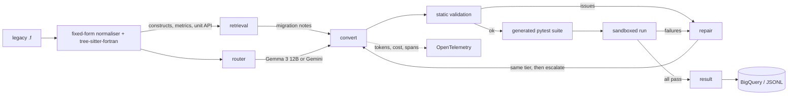

# Architecture

## Data flow for one module

1. **Analysis** (`modernizer.parsing`). Fixed-form FORTRAN 77 (columns, labels, continuation
   lines, Hollerith constants, blank-insensitive keywords) is normalised into statements that
   tree-sitter-fortran parses. 47 construct detectors (registry in `modernizer.features`) report
   hits with their original line numbers: GOTO webs, arithmetic IF, COMMON, EQUIVALENCE,
   column-major arrays, FORMAT I/O and so on. A per-unit symbol table (declared and implicit
   types, array ranks) drives the heuristic detectors and the **unit API**: for every
   `SUBROUTINE`/`FUNCTION` the parameters, their types and ranks, and which scalar dummies the
   routine writes. Fortran passes by reference and Python does not, so the written scalars
   become return values.
2. **Calling convention** (`modernizer.conventions`). One text, shared by converter, validator
   and test generator, defines the mapping: names and parameters, returned outputs in
   parameter order, numpy arrays modified in place with `i -> i-1` indexing, alternate
   returns, COMMON as module state, reload-safe initial state.
3. **Retrieval** (`modernizer.retrieval`). A curated corpus of migration notes is embedded
   and stored in a vector index: a local numpy index offline, Vertex AI Vector Search in
   production. The query is built from the detected constructs; results are re-ranked with a
   boost for matching constructs and every detected construct is guaranteed a note.
4. **Routing** (`modernizer.routing`). A transparent difficulty score in `[0, 1]` decides
   between the open model (Gemma 3 12B) and the frontier model (Gemini). Modules containing
   constructs that small models fail systematically on (EQUIVALENCE, assigned GOTO, ENTRY,
   alternate RETURN, sequence association) always go to the frontier model.
   The share of a batch routed to the open model is a policy parameter
   (`--open-fraction 0.7`): the threshold is calibrated on the batch itself. It can also be
   calibrated from observed outcomes (`calibrate_from_outcomes`).
5. **Conversion** (`modernizer.conversion`). The prompt carries the calling convention, the
   catalogue of runtime helpers, the per-unit API contract, a checklist of the constructs found
   by the parser with line numbers, the retrieved notes and the source with a line-number
   gutter. Large modules are split by program unit; shared COMMON/BLOCK DATA state is
   converted once as a prelude.
6. **Runtime** (`modernizer.runtime.f77rt`). A standalone helper module the converted code
   imports: truncating integer division, `MOD`/`SIGN`/`NINT` semantics, DO trip counts,
   blank-padded `CHARACTER`, FORMAT-driven formatted I/O, file units, bit operations, machine
   constants.
7. **Validation** (`modernizer.parsing.validate`). Python's own `compile`, a check that every
   unit exists with the contract's parameter names and return shape, that only allowed
   imports and real `f77rt` helpers are used, and that no Fortran leftovers remain. Findings
   go back to the model as repair feedback.
8. **Tests** (`modernizer.testing`). The model writes a pytest suite from the Fortran source
   and the unit contract, deriving expected values by simulating Fortran semantics. It is
   checked on the AST against a deny-list, generated once per module and reused for every
   attempt and tier, and run in a subprocess with a scrubbed environment and a timeout.
9. **Repair and escalation** (`modernizer.pipeline`). Up to `max_repairs` rounds on the
   starting tier, then one escalation to the frontier model that sees the failing attempt and
   its feedback.
10. **Metering** (`modernizer.telemetry`). Every model call goes through a wrapper that records
    tokens, cost, latency and a span, and writes a call record to the result sink.
11. **Persistence** (`modernizer.sinks`). Per-module and per-call rows go to JSONL and/or
    BigQuery (`deploy/bigquery` has the schemas and analysis views).

## Interfaces

`modernizer.protocols` defines `LLMClient`, `Embedder`, `VectorIndex` and `ResultSink`. Every
cloud-backed class has an offline counterpart implementing the same protocol, so the whole
pipeline runs without credentials in tests.

## Why the tests are shared across tiers

The comparison "does the open model match the frontier model" is only meaningful if both are
judged by the same tests. Generating tests per tier would measure the test writer as much as
the converter. By default the frontier model writes the tests, and that cost is reported
separately so that the effect of routing can be isolated from the fixed cost of testing.

## Known limits

* Generated tests encode the model's reading of the Fortran source. There is no Fortran
  compiler in the loop to produce ground truth, so a wrong test can reject a correct
  conversion and a weak test can accept a wrong one. The benchmark corpus therefore also
  carries held-out reference tests, derived by hand from the Fortran semantics and checked by
  mutation testing, which are used only for scoring. Differential testing against a compiled
  gfortran build of the legacy code would be the stronger oracle and is the main missing piece.
* Single-precision `REAL` is computed in float64, so results are compared with tolerances.
* List-directed output (`WRITE(*,*)`) is only approximated; explicit FORMATs are exact.
* Detectors for heuristic constructs (integer division, sequence association, implicit
  typing) are rule based and can miss or over-report.
* The AST deny-list for generated tests is a best-effort guard. Isolation relies on the
  container.
* The open model is self-hosted and billed per accelerator hour, not per token. A per-token
  cost comparison needs an amortised price computed from the real node price and measured
  throughput (`modernizer.llm.pricing.amortised_price_per_mtok`).
